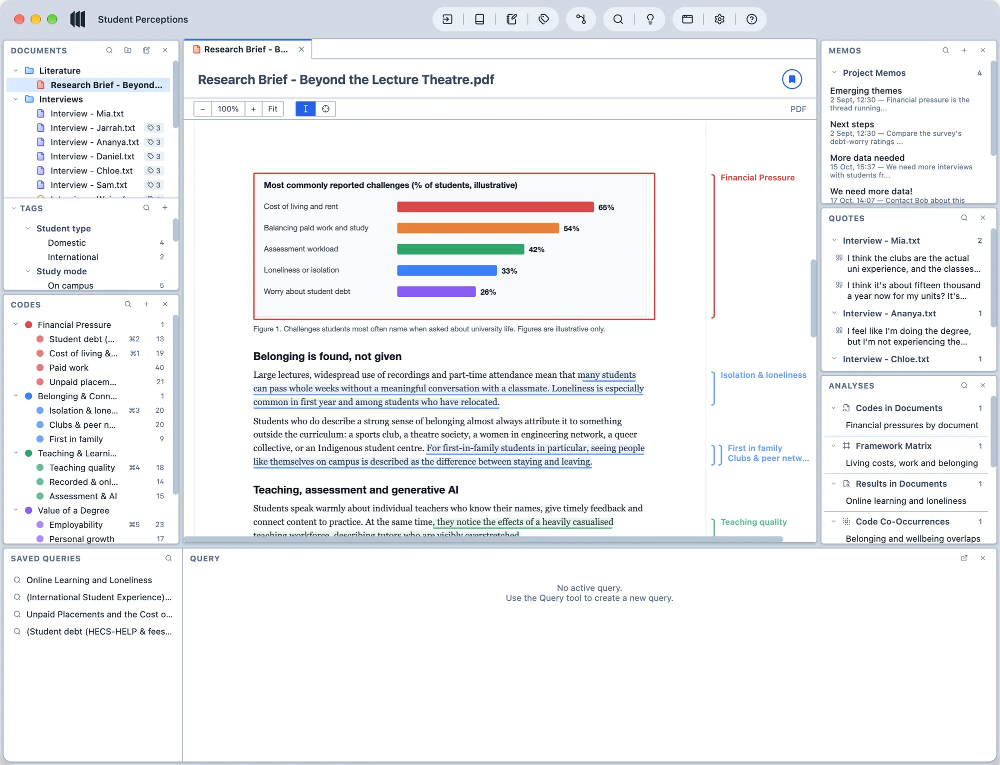

<p align="center">
  
</p>

# Magnolia Realtime

A fork of [Magnolia](https://github.com/caledavis/Magnolia), the free and open-source qualitative data analysis (QDA) software, that adds **optional real-time collaborative coding** through a database you own (Supabase / Postgres).

Magnolia stays local-first. Without sync, it works exactly as before: local files and the open QDPX standard. With sync, a team can code the same project at the same time.

Released under the European Union Public Licence (EUPL), like the original.

<p align="center">
  
  
</p>

## What this fork adds

### Magnolia Sync (bring your own database)

- **Your database, your data.** Connect to a free-tier Supabase project (or compatible Postgres) that you control. No third-party service, subscription or Magnolia-run cloud is involved.
- **Real-time collaboration.** Codes, codings, documents, memos, relationships, queries, folders and tags sync between researchers. Realtime is used as a wake-up signal, and changes are pulled by a sequence cursor so nothing is missed.
- **Optimistic and offline-capable.** Edits apply locally at once and are pushed in the background through an outbox that survives restarts and reconnects.
- **Conflict-safe.** Every entity has a GUID and a version, and writes are compare-and-swap. Different-field edits merge automatically. Same-field edits, overlapping text edits and delete-versus-edit become conflicts that you resolve with "Keep mine" or "Take theirs". Codings are separate entities, so two people coding the same passage never collide.
- **Text merge and selection rebasing.** Concurrent text edits are merged, and selections and codes are rebased onto the new text.
- **Media sync.** Images, audio, video and PDFs are uploaded by content hash (SHA-256) to a private storage bucket and downloaded on demand.
- **Roles and security.** Owner, editor and viewer roles are enforced with row-level security and membership checks, not by sharing a key. Viewers are read-only. Service-role and secret keys are rejected, and credentials are stored with the operating system's secure storage (Electron `safeStorage`).
- **Presence and activity.** See who is online and a log of who changed what and when.
- **Join and merge.** Joining an existing project opens Magnolia's Merge review, so you can reconcile local work with the shared project.
- **Status badge.** A badge shows connection state, pending changes and conflicts.

### Planned: accounts, invites and splash-screen sign-in (Part 2)

- Username and password accounts that do not depend on an invitation, with the author's name shown on every change.
- Invitations with a role (editor or viewer) and an expiry time, usable by multiple people until they expire or are revoked.
- A "Sign in / Sync…" button on the splash screen, so you can connect to a shared project without creating a local one first.
- A full step-by-step database setup guide.

See [docs/sync-part2-plan.md](docs/sync-part2-plan.md).

## Quick start

Requirements: a current Node.js LTS and a Supabase project (the free tier works).

```bash
git clone https://github.com/gamingteacher/Magnolia-Realtime
cd Magnolia-Realtime
npm install
npm run dev
```

1. In Supabase, open the SQL editor and run [`src/renderer/sync/schema.sql`](src/renderer/sync/schema.sql). It is idempotent, so it is safe to run again after updates.
2. In Magnolia, open **Preferences → Cloud Sync** and enter your project URL and publishable (anon) key.
3. Create or join a project and start syncing. Share the invite code with your team.

More detail is in the manual page [manual/guide/sync.md](manual/guide/sync.md).

### Scripts

| Command | Purpose |
| --- | --- |
| `npm run dev` | Run the app in development |
| `npm run build` | Build main, preload and renderer bundles |
| `npm test` | Run the unit tests (Vitest) |
| `node scripts/sync-e2e.mjs` | Live backend check against your Supabase project |
| `npm run package:linux` / `:mac` / `:win` | Build installers |

The e2e script reads the Supabase URL and publishable key from the environment (`SUPABASE_URL`, `SUPABASE_ANON_KEY`). Use a disposable project, because it creates test data.

## Where the sync code lives

| Path | Role |
| --- | --- |
| `src/renderer/sync/schema.sql` | Tables, row-level security and RPCs |
| `src/renderer/sync/engine.ts` | Outbox, pull, conflict logic |
| `src/renderer/sync/entity-map.ts` | Maps project data to synced entities |
| `src/renderer/sync/text-merge.ts`, `rebase.ts` | Text merge and selection rebasing |
| `src/renderer/sync/store-bridge.ts` | Connects the engine to the zustand stores |
| `src/renderer/sync/supabase-backend.ts`, `session.ts` | Backend and session orchestration |
| `src/main/sync-credentials.ts` | Secure credentials, state and media IPC |
| `src/renderer/components/Preferences/CloudSyncSettings.tsx` | Settings UI |

## Everything else

All other features (query builder, analysis tools, transcription, video and survey coding, native QDPX support and the supported document types) are inherited unchanged from Magnolia. See the original project for their documentation and for official release downloads.

## Known limitations

- The Electron UI for sync has been verified at the backend level and with unit tests. Please report problems you find when running it.
- Supabase free-tier limits apply (for example 50 MB per file, and projects pause when idle).
- Sign-in currently uses anonymous Supabase auth until Part 2 lands.

## Licence

European Union Public Licence (EUPL), as in the original. If you distribute this software or a derivative, you must do so under the EUPL and make the source code available.
