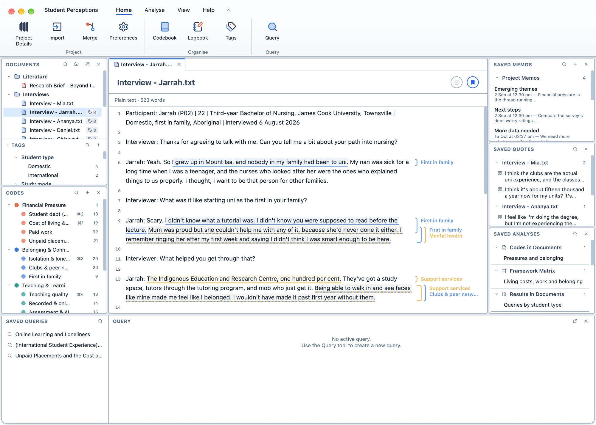
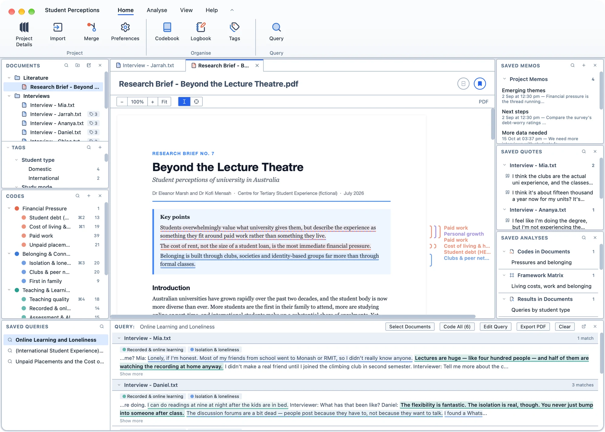
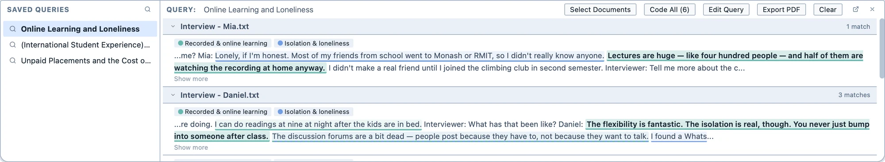
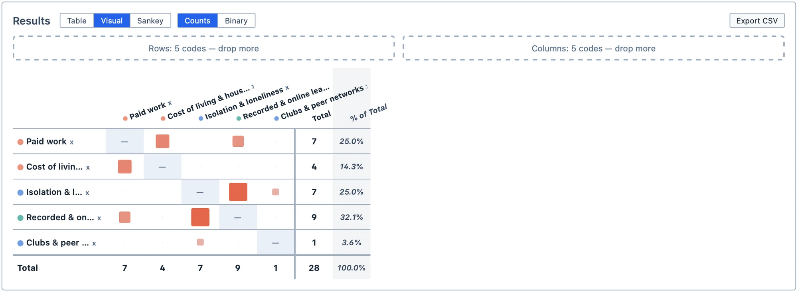
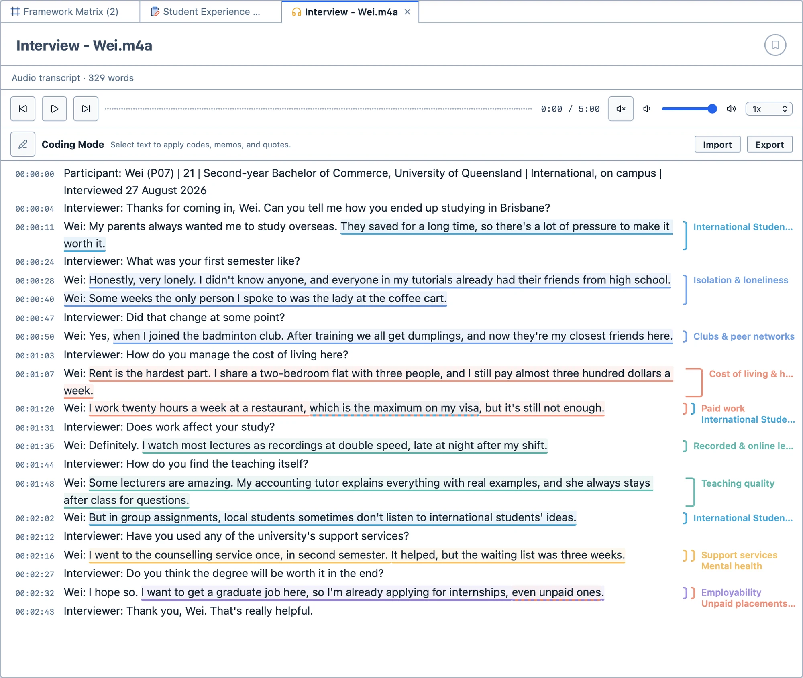
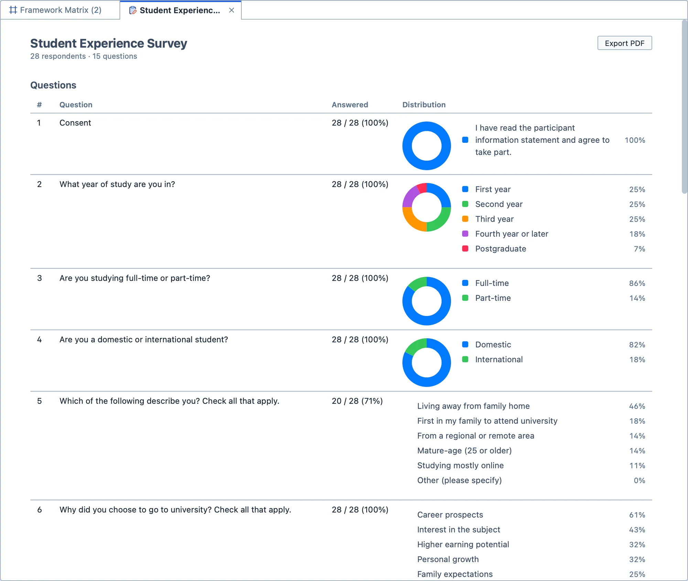

<p align="center">
  
</p>

# Magnolia Realtime

A fork of [Magnolia](https://github.com/caledavis/Magnolia), the free and open-source qualitative data analysis (QDA) software, that adds **optional real-time collaborative coding** through a database you own (Supabase / Postgres).

Magnolia stays local-first. Without sync, it works exactly as before: local files and the open QDPX standard. With sync, a team can code the same project at the same time.

Based on Magnolia 2.1 (Tauri 2 + Rust). Released under the European Union Public Licence (EUPL), like the original.


<p align="center">
  
  
</p>

## What this fork adds

### Magnolia Sync (bring your own database)

- **Your database, your data.** Connect to a free-tier Supabase project (or compatible Postgres) that you control. No third-party service, subscription or Magnolia-run cloud is involved.
- **Real-time collaboration.** Codes, codings, documents, memos, relationships, queries, folders and tags sync between researchers. Realtime is used as a wake-up signal, and changes are pulled by a sequence cursor so nothing is missed.
- **Optimistic and offline-capable.** Edits apply locally at once and are pushed in the background through an outbox that survives restarts and reconnects.
- **Conflict-safe.** Every entity has a GUID and a version, and writes are compare-and-swap. Different-field edits merge automatically. Same-field edits, overlapping text edits and delete-versus-edit become conflicts that you resolve with "Keep mine" or "Take theirs". Codings are separate entities, so two people coding the same passage never collide.
- **Text merge and selection rebasing.** Concurrent text edits are merged, and selections and codes are rebased onto the new text.
- **Media sync.** Images, audio, video and PDFs are uploaded by content hash (SHA-256) to a private storage bucket and downloaded on demand.
- **Roles and security.** Owner, editor and viewer roles are enforced with row-level security and membership checks, not by sharing a key. Viewers are read-only. Service-role and secret keys are rejected, and credentials are stored with the operating system's secure storage (an AES-256 key held in the OS keychain).
- **Presence and activity.** See who is online and a log of who changed what and when.
- **Join and merge.** Joining an existing project opens Magnolia's Merge review, so you can reconcile local work with the shared project.
- **Status badge.** A badge shows connection state, pending changes and conflicts.

## Install

To get started, download the latest release for your operating system from the [Releases page](https://github.com/gamingteacher/Magnolia-Realtime/releases).

Depending on your OS, look for the following file types:

- **Windows:** Download the `.exe` installer.
- **Linux:** Download the `.AppImage`, `.deb`, or `.rpm` package.

The app updates itself from the Releases page. macOS builds are not published.

Once downloaded, follow the standard installation instructions for your operating system.

## Development

To build from source you need a current Node.js LTS, a [Rust toolchain](https://rustup.rs), the [Tauri system dependencies](https://tauri.app/start/prerequisites/) (on Fedora: `webkit2gtk4.1-devel gtk3-devel librsvg2-devel libappindicator-gtk3-devel dbus-devel openssl-devel`), and a Supabase project (the free tier works).

```bash
git clone https://github.com/gamingteacher/Magnolia-Realtime
cd Magnolia-Realtime
npm install
npm run dev
```

1. In Supabase, open the SQL editor and run [`src/renderer/sync/schema.sql`](src/renderer/sync/schema.sql). It is idempotent, so it is safe to run again after updates.
2. In Magnolia, open **Preferences → Cloud Sync** and enter your project URL and publishable (anon) key.
3. Create or join a project and start syncing. Share the invite code with your team.

More detail is in the manual page [manual/guide/sync.md](manual/guide/sync.md).

### Scripts

| Command | Purpose |
| --- | --- |
| `npm run dev` | Run the app in development |
| `npm run build` | Build the installers with Tauri |
| `npm run typecheck` | Type-check the renderer |
| `npm test` | Run the unit tests (Vitest and cargo) |
| `node scripts/sync-e2e.mjs` | Live backend check against your Supabase project |

The e2e script reads the Supabase URL and publishable key from the environment (`SUPABASE_URL`, `SUPABASE_ANON_KEY`). Use a disposable project, because it creates test data.

## Where the sync code lives

| Path | Role |
| --- | --- |
| `src/renderer/sync/schema.sql` | Tables, row-level security and RPCs |
| `src/renderer/sync/engine.ts` | Outbox, pull, conflict logic |
| `src/renderer/sync/entity-map.ts` | Maps project data to synced entities |
| `src/renderer/sync/text-merge.ts`, `rebase.ts` | Text merge and selection rebasing |
| `src/renderer/sync/store-bridge.ts` | Connects the engine to the zustand stores |
| `src/renderer/sync/supabase-backend.ts`, `session.ts` | Backend and session orchestration |
| `src-tauri/src/sync.rs` | Secure credentials, state and media transfer (Tauri commands) |
| `src/renderer/components/Preferences/CloudSyncSettings.tsx` | Settings UI |

## Everything else

The query builder, analysis tools, transcription, video and survey coding, native QDPX support and supported document types come from Magnolia, and are updated with upstream releases. See the original project manual for documentation; download this fork from its Releases page.

## Known limitations

- The sync UI has been verified at the backend level and with unit tests. Please report problems you find when running it.
- Supabase free-tier limits apply (for example 50 MB per file, and projects pause when idle).

## Releasing

Push a `v*` tag. The Release workflow builds Windows and Linux installers with `tauri-action` and signs the updater artifacts with the `TAURI_SIGNING_PRIVATE_KEY` repository secret (and `TAURI_SIGNING_PRIVATE_KEY_PASSWORD`).

## Licence

Magnolia is free and released under the European Union Public Licence. This means that everyone is free to use Magnolia, reproduce it, change it, and make their changes available to others (among other things). Importantly, if Magnolia or a derivative of it is distributed, it must also be done under the EUPL licence and the source code must be made freely available.

This ensures that Magnolia remains free for everyone, and disincentivises companies from profiting off it.

## Powerful coding, powerful queries

<p align="center">
  
</p>

Magnolia's intuitive, graphical query builder lets you build powerful queries to explore your data.

You can save your queries for later, and see the results update in real-time—even while coding data.

You can selectively apply queries to specific documents, types of documents, documents in specific folders, and/or documents with specific tags. 

## A rich suite of analysis tools

<p align="center">
  
</p>

Magnolia's rich suite of analytical tools allow you to interrogate your data. You can selectively apply these tools to specific documents, types of documents, documents in specific folders, and/or documents with specific tags.  

- **Relationships:** Map anything and everything. Just drag it to the canvas! Everything on your canvas is interactive; just double-click and you will be taken there. You can even export your map as an SVG file.

- **Codes in Documents:** Easily see which codes exist in which documents.

- **Framework Matrix:** Summarise coded information in a Framework Matrix, 

- **Results in Documents:** Want to see how different queries produce different results? Easily see how many results different queries produce for each document in your project. 

- **Code Co-Occurrences:** See which codes overlap with each other. 

- **Code Orders:** Explore the order codes appear in your data. 

- **Code Frequencies:** Easily see how much of each document is covered by particular codes.

- **Word Frequencies:** See which words appear how often, in whole documents or only in the passages coded with particular codes. See the data displayed as a chart or a word cloud.

- **Word Combinations:** See which words go together: phrases that repeat, the words that tend to appear in the same sentences as a word you choose, and a word tree of everything that comes before and after it.

- **Reports:** Combine analysis results, documents, queries, and more into a PDF report.

## Easily transcribe audio and video

Transcribing audio and video makes it much easier to code.

Magnolia lets you transcribe audio and video. Naturally, you can do this with a foot pedal. Simply map keys to your foot pedal's buttons and then tell Magnolia that those keys are used to play, fast-forward, and rewind. Easy! There's no need for separate software.

Magnolia does not include AI transcription.

<p align="center">
  
</p>

## Intuitive video coding

Qualitative researchers know that videos capture more than just words. The picture is also important! Because of this, Magnolia syncs your video codes to timestamps. 

This means that when you code a transcript, your codes also appear in the video timeline. If you code in the video timeline, your codes also appear in the transcript. The transcript and the video are linked!

## Support for survey data

<p align="center">
  
</p>

Other QDA software breaks your survey responses into individual documents. Magnolia doesn't!

Magnolia's survey summary page allows you to easily see the results of your survey at a glance. See which percentage of respondents answered each question, or selected which options. Numerical data is presented as box plots (with the number of respondents, the mean, median, and mode). Go deeper into each respondent's answers, or compare how different respondents answered a question. 

You can also export a report with all your survey data.

## Native QDPX support

Magnolia reads and writes the QDPX format as standard. This is the open standard for qualitative data analysis. Other software defaults to proprietary formats. Magnolia does not!

Of course, there are some features in Magnolia which the QDPX format does not support. Magnolia overcomes this problem by including the Magnolia-specific features in a special part of the QDPX file. This means that other software (such as Atlas.ti and MAXQDA) can open Magnolia files without any problem, and will just ignore the Magnolia-specific features. 

## Supported document types

- Text: .txt, .md, .markdown, .pdf, .docx, .rtf, .odt (Magnolia converts .docx, .rtf, and .odt files to .pdf when they are imported)
- Images: .jpg, .jpeg, .png, .gif, .webp, .tif, .tiff, .heic, .heif 
- Audio: .wav, .mp3, .ogg, .flac, .m4a, .aac
- Video: .mp4, .mov, .avi
- Surveys: .csv, .xlsx

## No AI; optional sync

Magnolia does not contain any AI features. There's no AI analysis, and no AI transcription. You are the researcher! Sync is optional and uses the database you configure; local projects remain supported.

Without sync, data stays in local project files or on a network drive. With Magnolia Sync, your team can collaborate through your own Supabase/Postgres project.

There is nothing in Magnolia which requires a subscription.

## Troubleshooting

### Linux AppImage fails with "error loading libfuse.so.2"

AppImages need **libfuse2** to mount themselves at launch. Several recent
distros (Fedora 41+, Ubuntu 24.04+, and others) no longer ship it by default,
so the AppImage fails immediately with:

```
dlopen(): error loading libfuse.so.2
AppImages require FUSE to run.
```

Two ways to fix it:

- **Use the .deb or .rpm package instead** — they install their own
  dependencies automatically and don't need FUSE. See the download links
  above.
- **Or install libfuse2** and keep using the AppImage:
  - Fedora/RHEL: `sudo dnf install fuse-libs`
  - Ubuntu/Debian: `sudo apt install libfuse2`
  - Arch: `sudo pacman -S fuse2`
